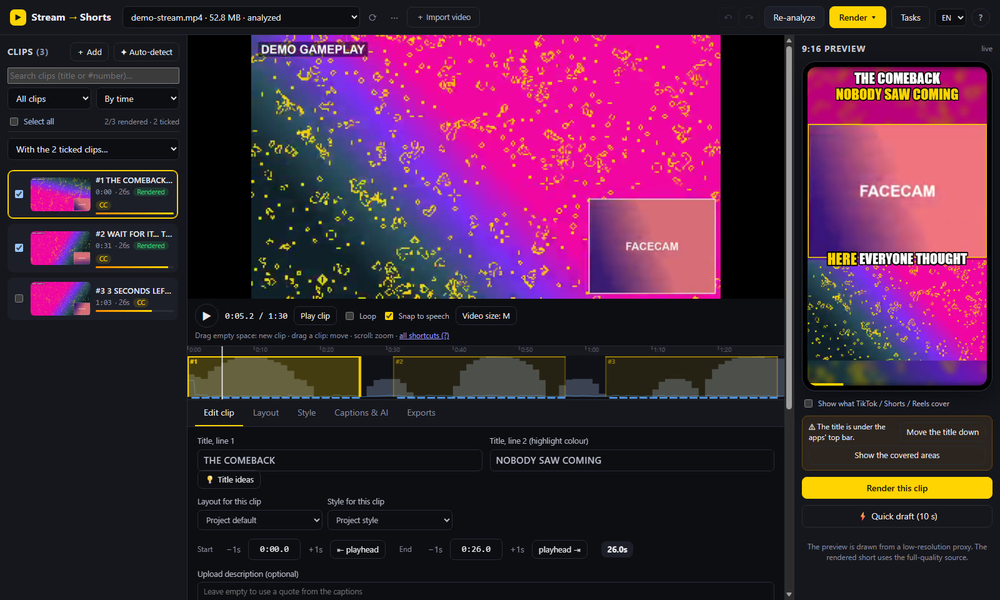
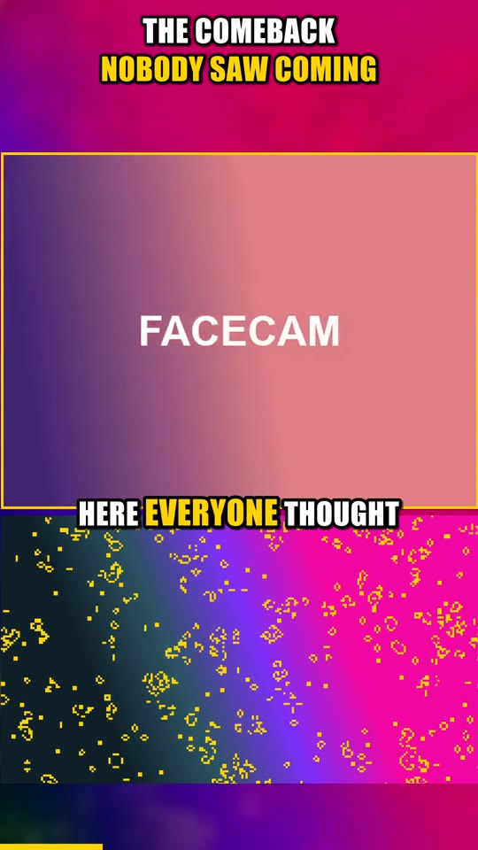

<h1 align="center">Stream → Shorts</h1>

<p align="center">
  <b>Turn long stream recordings into vertical Shorts, TikToks and Reels with animated captions.</b><br>
  Free, open source and 100% local: no account, no upload, no cloud.
</p>

<p align="center">
  <a href="LICENSE"></a>
  
  
  
  <a href="https://buymeacoffee.com/mastersrecipes"></a>
</p>

<p align="center">
  
</p>

Stream → Shorts finds the strongest moments of a stream (loudness + on-screen action), lets you trim and title them in a simple web interface, and renders 9:16 videos with a facecam + gameplay layout, a title and word-by-word captions made by speech recognition **on your own machine**.

## Features

<table>
<tr>
<td width="62%" valign="top">

- **Finds the best moments** automatically from loudness and scene changes; add or adjust clips on a timeline.
- **Vertical 9:16 layouts:** facecam + gameplay, gameplay only or facecam only, with a blurred background, title, progress bar and loudness normalisation.
- **Animated captions** with word-by-word highlight, generated offline with [whisper.cpp](https://github.com/ggml-org/whisper.cpp). Fix words once for the whole video, tell the AI which names and jargon to expect, edit any line by hand.
- **Never cut mid-word:** clip edges snap to pauses in speech.
- **Safe zones:** see what TikTok / Shorts / Reels buttons cover, with one-click fixes.
- **Quick 10-second drafts**, a render queue with progress and time left, resume after the app was closed, undo / redo.
- **Upload texts:** title, description and hashtags saved next to every short.
- **Several videos side by side**, each with its own project, plus style presets, title ideas, bulk actions and keyboard shortcuts.
- **English and French** interface. Works on **Windows** and **Linux** (Kali, Debian, Ubuntu).

</td>
<td width="38%" valign="top" align="center">
  <br>
  <sub>A finished short (demo footage)</sub>
</td>
</tr>
</table>

## Quick start

You need [Node.js](https://nodejs.org) 18 or newer. The setup downloads ffmpeg, whisper.cpp and the speech model (about 700 MB, once).

### Windows

1. Download this repository (**Code → Download ZIP**, then unzip) or `git clone` it.
2. Double-click **`setup.bat`** (once).
3. Double-click **`start.bat`**. Your browser opens at http://127.0.0.1:5199.

### Linux (Kali, Debian, Ubuntu)

```bash
git clone https://github.com/ANIR13/stream-to-shorts.git
cd stream-to-shorts
chmod +x setup.sh start.sh
./setup.sh     # once: installs nodejs, ffmpeg, fonts; builds whisper.cpp; downloads the model
./start.sh
```

A step-by-step PDF for Kali Linux is in [`docs/Kali-Linux-Guide.pdf`](docs/Kali-Linux-Guide.pdf).

## How to use

1. Put a recording in the **`source/`** folder (or drop it on the app window) and pick it in the list.
2. Click **Analyze video**: the strongest moments become clips.
3. Check the **Layout** (facecam and gameplay boxes), give each clip a title, review the captions.
4. **Render ▾** → all clips. Finished shorts go to **`output/<video name>/`**.

Everything else (captions, styles, shortcuts, several videos, troubleshooting) is in the **[user guide](docs/USER-GUIDE.md)**. Press **?** in the app for keyboard shortcuts.

## Privacy

The app runs a small web server bound to `127.0.0.1` only (not reachable from other machines), has no login, no telemetry and never uploads anything. The only internet access is the one-time download in `setup.bat` / `setup.sh`.

## Project layout

| Path | What it is |
|---|---|
| `app/server.js` | Entry point and HTTP routes. Node.js only, no npm packages. |
| `app/src/` | The server in layers: core logic, services (detection, transcription, rendering, exports, job queue), project repository, FFmpeg adapter. See **[docs/ARCHITECTURE.md](docs/ARCHITECTURE.md)**. |
| `app/public/` | The web interface (plain HTML, CSS and JavaScript). `layout.js` is shared by the preview and the renderer. |
| `tests/` | Automated tests: `npm test` (no ffmpeg or whisper needed). |
| `setup.*`, `start.*` | Setup and launchers for Windows and Linux. |
| `source/`, `output/`, `projects/` | Your recordings, finished shorts and project data (not part of the repository). |
| `tools/` | ffmpeg, whisper.cpp and the speech model, downloaded by setup (not part of the repository). |

There is no build step: edit the files and restart the app.

## Contributing

Bug reports, ideas and pull requests are welcome. Please read **[CONTRIBUTING.md](CONTRIBUTING.md)** first: it explains how to run the app from source and the few project rules (no dependencies, fully local, Windows + Linux, English + French). For bigger changes, open an issue first.

## Support

If Stream → Shorts saves you time, you can support its development:

[](https://buymeacoffee.com/mastersrecipes)

## Credits

- [FFmpeg](https://ffmpeg.org) for all video and audio processing (Windows builds by [BtbN](https://github.com/BtbN/FFmpeg-Builds), licensed GPL).
- [whisper.cpp](https://github.com/ggml-org/whisper.cpp) (MIT) and the [OpenAI Whisper](https://github.com/openai/whisper) models (MIT) for speech recognition.

These tools are downloaded by the setup scripts and are not included in this repository; their own licenses apply.

## License

[MIT](LICENSE) © 2026 ANIR13
