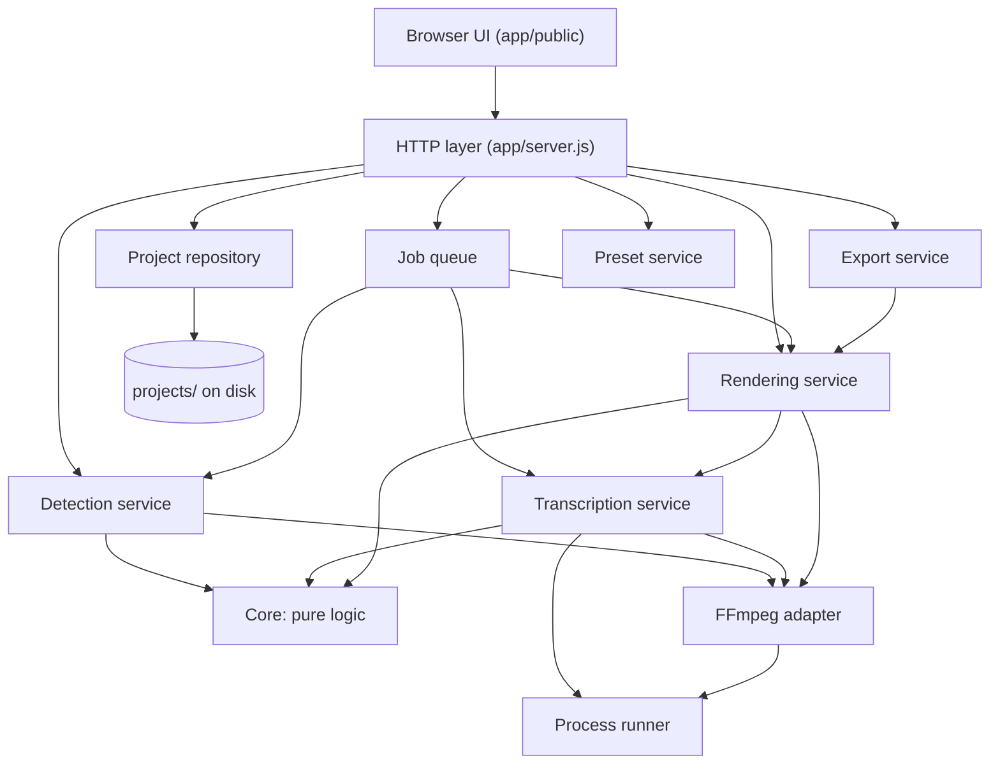

# Architecture

Stream → Shorts is a small local web app: a Node.js server (no npm packages) and a plain HTML/CSS/JavaScript interface. The server is split into layers with one job each, wired together with ordinary factory functions (no dependency-injection framework).



## Folders

| Path | Layer | What it holds |
|---|---|---|
| `app/server.js` | Entry point and HTTP | Builds the application (`createApp`), maps each API route to a service, serves static and media files. |
| `app/src/shared/` | Shared | `errors.js` (HTTP errors, plain-language task errors), `fsutil.js` (JSON files, paths), `stats.js` (moving average, robust z-score). |
| `app/src/infrastructure/` | Infrastructure | `process.js` (running programs, opening folders), `environment.js` (folders, tools, environment), `ffmpeg.js` (**FFmpeg adapter**: the only place that knows how ffmpeg/ffprobe are called), `trash.js` (Recycle Bin / desktop trash). |
| `app/src/core/` | Core logic, no I/O | `project.js` (defaults, clip numbers, merging browser saves), `schema.js` (project file versions and migrations), `detection.js` (highlight scoring), `captions.js` (word fixes, hint-word echo, whisper parsing, caption lines), `render.js` (subtitle file and filter graph), `upload.js` (upload texts). |
| `app/src/repository/` | Persistence | `projectRepository.js`: projects on disk, per-project locks, revisions. |
| `app/src/services/` | Application services | `detectionService.js` (analysis, preview copy, suggested clips), `transcriptionService.js` (whisper.cpp, captions), `renderingService.js` (shorts and quick drafts), `exportService.js` (output files, upload texts), `presetService.js`, `jobQueue.js` (one task at a time, cancel, retry, resume after restart). |
| `app/public/` | Browser | `app.js` (interface), `layout.js` (9:16 layout maths shared with the renderer), `timing.js` (clip time rules and snap-to-speech, shared with the server), `i18n.js` (French), `index.html`, `styles.css`. |
| `tests/` | Tests | `unit/`, `integration/`, `e2e/`, `regression/`: see [TESTING.md](TESTING.md). |

## Rules of the layers

- **Core** functions are pure: same input, same output, no files, no programs, no clock (except where a timestamp is the point). They are the easiest place to add logic and to test it.
- **Infrastructure** talks to the operating system. Nothing else spawns processes or knows tool command lines.
- **Services** combine core logic, the repository and infrastructure. They receive their dependencies as arguments (`createXService({ repo, ffmpeg, ... })`), so tests pass fakes.
- **The HTTP layer** only parses requests, calls services and formats responses. API paths, inputs, outputs and status codes are part of the contract with the browser: keep them compatible.
- **All project writes** go through `repo.update(slug, mutate)`, which serializes writes per project.

## Project file versions

Each `projects/<video>/project.json` has a `version` field: the **project file format**. `app/src/core/schema.js` defines the current format (`SCHEMA_VERSION`) and one migration per step (`MIGRATIONS[n]` upgrades format `n` to `n + 1`).

- **Loading** upgrades older projects in memory, so every service sees the current format.
- **Opening a video** writes the upgrade once and keeps the original file as `project.v<N>.backup.json`.
- **A project from a newer app** (for example made on another computer with a newer version) is refused with a clear message and never overwritten, so an older app can't destroy data it doesn't understand.

| Format | What changed |
|---|---|
| 1 | First releases (projects without a `version` field count as 1). |
| 2 | Settings added since then are written into the file: word fixes and hint words, upload hashtags, setup checklist, detection weights and spacing; clips get permanent numbers. |

**To change what `project.json` contains:** bump `SCHEMA_VERSION`, add `MIGRATIONS[old]` that upgrades a project in place, add a test in `tests/schema.test.js`, and add a row to the table above. Never edit a migration that was released.

## Tests

Tests are grouped in four levels (unit, integration, end-to-end with the real FFmpeg, regression) and use only `node:test`. **[docs/TESTING.md](TESTING.md)** explains how to run them, what each level guarantees and how to add tests.

```bash
npm test          # everything; the end-to-end test is skipped when FFmpeg isn't installed
```

## Next steps

The browser interface (`app/public/app.js`) is still one file; splitting it into modules (timeline, editor, preview, tasks) is a possible follow-up.
