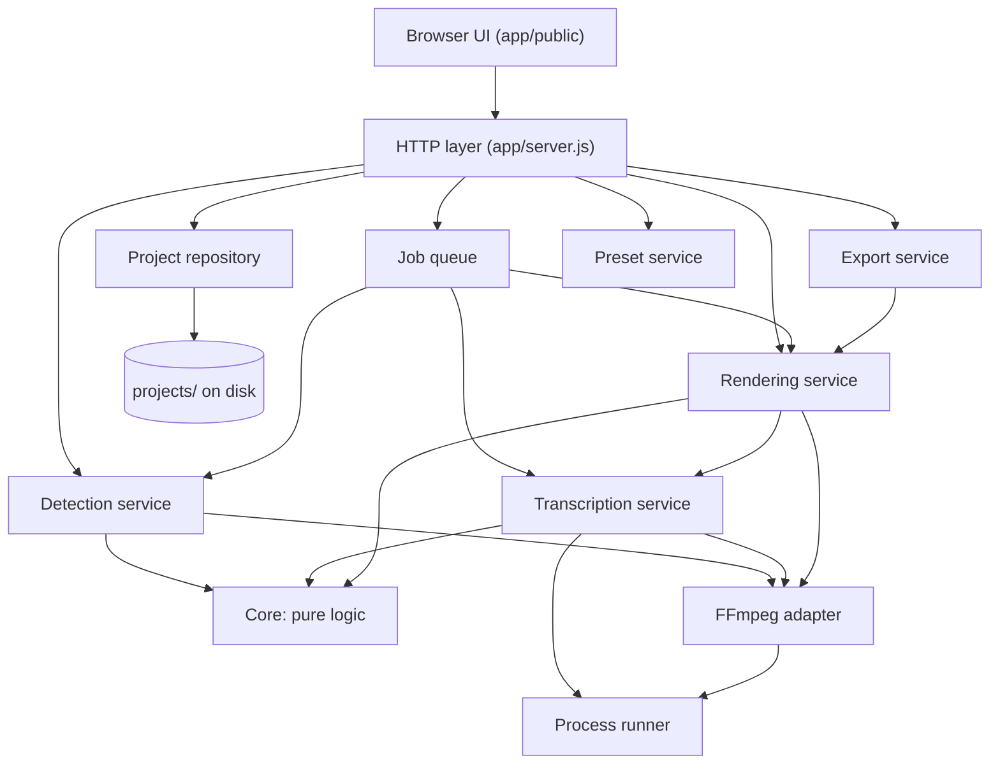

# Architecture

Stream → Shorts is a small local web app: a Node.js server (no npm packages) and a plain HTML/CSS/JavaScript interface. The server is split into layers with one job each, wired together with ordinary factory functions (no dependency-injection framework).



## Folders

| Path | Layer | What it holds |
|---|---|---|
| `app/server.js` | Entry point and HTTP | Builds the application (`createApp`), maps each API route to a service, serves static and media files. |
| `app/src/shared/` | Shared | `errors.js` (HTTP errors, plain-language task errors), `fsutil.js` (JSON files, paths), `validate.js` (safe file names and ids: everything from the browser or a project file passes here), `stats.js` (moving average, robust z-score). |
| `app/src/infrastructure/` | Infrastructure | `process.js` (running programs, opening folders), `environment.js` (folders, tools, environment), `ffmpeg.js` (**FFmpeg adapter**: the only place that knows how ffmpeg/ffprobe are called), `trash.js` (Recycle Bin / desktop trash). |
| `app/src/core/` | Core logic, no I/O | `project.js` (defaults, clip numbers, merging browser saves), `schema.js` (project file versions and migrations), `detection.js` (fast highlight scoring), `smart.js` (smart multi-signal scoring, see [DETECTION.md](DETECTION.md)), `captions.js` (word fixes, hint-word echo, whisper parsing, caption lines), `timeline.js` (**timeline engine**: a short as tracks, compiled to ffmpeg inputs, see below), `render.js` (subtitle file and filter graph), `upload.js` (upload texts). |
| `app/src/repository/` | Persistence | `projectRepository.js`: projects on disk, per-project locks, revisions. |
| `app/src/services/` | Application services | `detectionService.js` (analysis, preview copy, suggested clips), `transcriptionService.js` (whisper.cpp, captions), `renderingService.js` (shorts and quick drafts), `exportService.js` (output files, upload texts), `presetService.js`, `jobQueue.js` (one task at a time, cancel, retry, resume after restart). |
| `app/public/` | Browser | The interface, split by feature (see [Browser interface](#browser-interface)); `layout.js` (9:16 layout maths shared with the renderer), `timing.js` (clip time rules and snap-to-speech, shared with the server), `i18n.js` (French), `index.html`, `styles.css`. |
| `tests/` | Tests | `unit/`, `integration/`, `e2e/`, `regression/`: see [TESTING.md](TESTING.md). |

## Rules of the layers

- **Core** functions are pure: same input, same output, no files, no programs, no clock (except where a timestamp is the point). They are the easiest place to add logic and to test it.
- **Infrastructure** talks to the operating system. Nothing else spawns processes or knows tool command lines.
- **Services** combine core logic, the repository and infrastructure. They receive their dependencies as arguments (`createXService({ repo, ffmpeg, ... })`), so tests pass fakes.
- **The HTTP layer** only parses requests, calls services and formats responses. API paths, inputs, outputs and status codes are part of the contract with the browser: keep them compatible.
- **All project writes** go through `repo.update(slug, mutate)`, which serializes writes per project.
- **Untrusted input:** requests are checked in `server.js` (own page only, see SECURITY.md), file names in `shared/validate.js`, and every project passes through `sanitizeProject` (`core/project.js`) when loaded and saved, so services can trust its values.

## Timeline engine

A short is described as data before anything is rendered (`app/src/core/timeline.js`):

```
clip (project.json)  --buildTimeline-->  timeline  --compileTimeline-->  { subtitle file, filter graph, extra inputs, seek, duration }
```

| Track | Kind | From the clip |
|---|---|---|
| `video` | Layers of the layout: background (blurred or dark), gameplay, facecam | Layout and style |
| `images` | Picture overlays (PNG, JPG, WebP from `source/`), position, size, opacity, timing | `clip.images` |
| `title`, `captions`, `texts` | Rendered by libass: title, word-by-word captions, extra text overlays | Titles, `clip.captions`, `clip.texts` |
| `stream`, `music` | The recording's sound; a music file (looped, faded, ducked under speech with side-chain compression) | `clip.music` |

- **Cuts** (`clip.cuts`, absolute source times) remove parts of a clip. The kept parts are trimmed and joined in the graph (jump cuts); every timed item (captions, texts, pictures) is moved to the new times, and the source is read only from the first kept moment.
- **Hidden** tracks are left out of the render; **locked** tracks are an editor setting (the interface refuses changes; timing locks the clip's edges).
- **Transitions** are the fades at the clip edges.
- **One description, three readers:** the renderer compiles it, the live preview draws the same overlays, the editor shows the cuts on the timeline.
- **Compatibility:** a clip without timeline fields compiles to exactly the subtitle file and graph of earlier versions (`tests/unit/timeline.test.js` checks every baseline layout), and its render fingerprint is unchanged.
- **Adding a track kind:** add it to `buildTimeline`, compile it in `compileTimeline` (with a graph addition in `render.js`), validate its fields in `sanitizeProject`, include it in `Layout.renderSig`'s extras, and test it with the real FFmpeg in `tests/e2e/timeline.test.js`.

## Browser interface

The interface has no build step. It is split by feature into small files that `index.html` loads in order as plain scripts sharing one global scope; `app.js`, loaded last, starts it.

| Folder | Files |
|---|---|
| `core/` | `util.js` (DOM helpers, formats, storage), `api.js` (calls to the server), `state.js` (page state `S`, saving), `history.js` (undo / redo), `videos.js` (opening videos, per-video place) |
| `editor/` | `clip-list.js`, `timeline.js`, `clip-editor.js` (Edit tab, title ideas), `caption-editor.js`, `clip-actions.js` (timing, trim, render, quick draft), `tracks.js` (Tracks tab: cuts, overlays, music, hide / lock) |
| `preview/` | `player.js`, `preview.js` (live 9:16 preview), `safe-zones.js`, `video-size.js` |
| `ai/` | `highlights.js` (moment strength, "Why this moment?"), `detect.js` (Auto-detect popover), `captions.js` (Captions & AI tab) |
| `tasks/` | `queue.js` (polling, batches), `progress.js` (Tasks panel), `notifications.js`, `render-all.js`, `interrupted.js` |
| `settings/` | `layout.js` (Layout tab), `style.js` (Style tab, presets) |
| `exports/` | `exports.js` (finished shorts, upload texts) |
| `components/` | `toast.js`, `modal.js`, `tabs.js`, `topbar.js`, `video-menu.js`, `drag-drop.js`, `shortcuts.js`, `language.js` |

Rules:

- **Top-level code in a file may only use what earlier files define.** Functions are called later (events, timers) can use anything. Start-up steps that need several files go in `app.js`. `npm run check` verifies that every file is listed once in `index.html` and `app.js` is last; `tests/e2e/ui.test.js` loads the real page in a headless browser and fails on any script error.
- **A new file** goes in the folder of its feature and gets a `<script>` tag in `index.html`, after the files it uses.
- **Next step:** turning these files into ES modules (`import` / `export`) once the shared state is narrowed down; the split already follows module boundaries.

## Project file versions

Each `projects/<video>/project.json` has a `version` field: the **project file format**. `app/src/core/schema.js` defines the current format (`SCHEMA_VERSION`) and one migration per step (`MIGRATIONS[n]` upgrades format `n` to `n + 1`).

- **Loading** upgrades older projects in memory, so every service sees the current format.
- **Opening a video** writes the upgrade once and keeps the original file as `project.v<N>.backup.json`.
- **A project from a newer app** (for example made on another computer with a newer version) is refused with a clear message and never overwritten, so an older app can't destroy data it doesn't understand.

| Format | What changed |
|---|---|
| 1 | First releases (projects without a `version` field count as 1). |
| 2 | Settings added since then are written into the file: word fixes and hint words, upload hashtags, setup checklist, detection weights and spacing; clips get permanent numbers. |
| 4 | The timeline: clips may have `cuts`, `texts`, `images`, `music` and `tracks` (hidden / locked). All optional; nothing to fill in. |
| 3 | Detection settings get the engine (`fast` or `smart`, fast by default) and the smart weights `wA wV wS wE wC`. Smart clips store `scoreEngine` and `scoreReasons`. |

**To change what `project.json` contains:** bump `SCHEMA_VERSION`, add `MIGRATIONS[old]` that upgrades a project in place, add a test in `tests/schema.test.js`, and add a row to the table above. Never edit a migration that was released.

## Tests

Tests are grouped in four levels (unit, integration, end-to-end with the real FFmpeg, regression) and use only `node:test`. **[docs/TESTING.md](TESTING.md)** explains how to run them, what each level guarantees and how to add tests.

```bash
npm test          # everything; the end-to-end test is skipped when FFmpeg isn't installed
```

## Next steps

See [ROADMAP.md](../ROADMAP.md).
