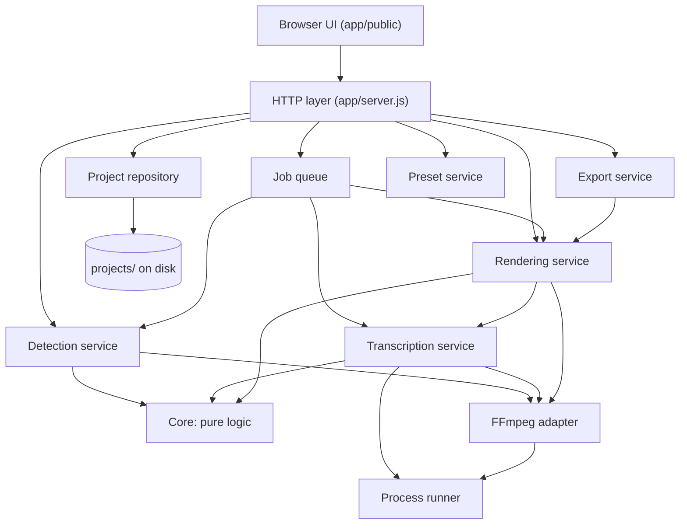

# Architecture

Stream → Shorts is a small local web app: a Node.js server (no npm packages) and a plain HTML/CSS/JavaScript interface. The server is split into layers with one job each, wired together with ordinary factory functions (no dependency-injection framework).



## Folders

| Path | Layer | What it holds |
|---|---|---|
| `app/server.js` | Entry point and HTTP | Builds the application (`createApp`), maps each API route to a service, serves static and media files. |
| `app/src/shared/` | Shared | `errors.js` (HTTP errors, plain-language task errors), `fsutil.js` (JSON files, paths), `stats.js` (moving average, robust z-score). |
| `app/src/infrastructure/` | Infrastructure | `process.js` (running programs, opening folders), `environment.js` (folders, tools, environment), `ffmpeg.js` (**FFmpeg adapter**: the only place that knows how ffmpeg/ffprobe are called), `trash.js` (Recycle Bin / desktop trash). |
| `app/src/core/` | Core logic, no I/O | `project.js` (defaults, clip numbers, merging browser saves), `detection.js` (highlight scoring), `captions.js` (word fixes, hint-word echo, whisper parsing, caption lines), `render.js` (subtitle file and filter graph), `upload.js` (upload texts). |
| `app/src/repository/` | Persistence | `projectRepository.js`: projects on disk, per-project locks, revisions. |
| `app/src/services/` | Application services | `detectionService.js` (analysis, preview copy, suggested clips), `transcriptionService.js` (whisper.cpp, captions), `renderingService.js` (shorts and quick drafts), `exportService.js` (output files, upload texts), `presetService.js`, `jobQueue.js` (one task at a time, cancel, retry, resume after restart). |
| `app/public/` | Browser | `app.js` (interface), `layout.js` (9:16 layout maths shared with the renderer), `i18n.js` (French), `index.html`, `styles.css`. |
| `tests/` | Tests | `node --test` suites; no server, ffmpeg or whisper needed. |

## Rules of the layers

- **Core** functions are pure: same input, same output, no files, no programs, no clock (except where a timestamp is the point). They are the easiest place to add logic and to test it.
- **Infrastructure** talks to the operating system. Nothing else spawns processes or knows tool command lines.
- **Services** combine core logic, the repository and infrastructure. They receive their dependencies as arguments (`createXService({ repo, ffmpeg, ... })`), so tests pass fakes.
- **The HTTP layer** only parses requests, calls services and formats responses. API paths, inputs, outputs and status codes are part of the contract with the browser: keep them compatible.
- **All project writes** go through `repo.update(slug, mutate)`, which serializes writes per project.

## Tests

```bash
npm test          # or: node --test tests/
```

- `tests/core.test.js` compares the core with `tests/fixtures/baseline.json`, outputs recorded from the code before the modular refactor on synthetic data. A change that alters what a rendered short looks like, or which moments are detected by default, fails here on purpose.
- `tests/infrastructure.test.js` tests the FFmpeg adapter with a fake process runner.
- `tests/repository.test.js` and `tests/services.test.js` run on temporary folders with fake ffmpeg / whisper.

If you change the output **on purpose**, regenerate the baseline (`node tests/fixtures/make-baseline.js`) and explain the change in your pull request.

## Next steps

The browser interface (`app/public/app.js`) is still one file; splitting it into modules (timeline, editor, preview, tasks) is a possible follow-up.
